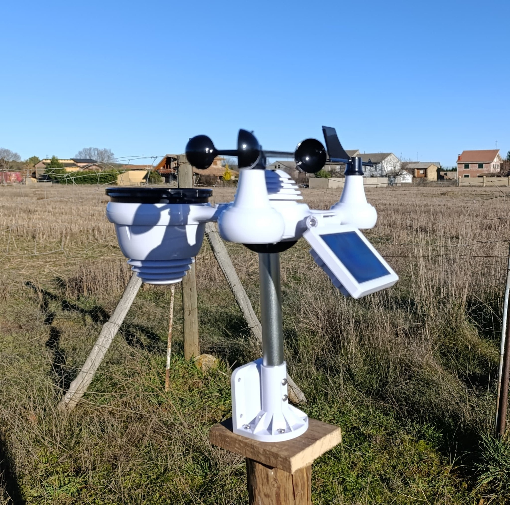

# weather-station

[](https://github.com/jke94/weather-station/actions/workflows/master_on_push_morning_daily_scheduler.yml)

[](https://github.com/jke94/weather-station/actions/workflows/morning_daily_scheduler_tweet_in_X.yml)

[](https://github.com/jke94/weather-station/actions/workflows/morning_daily_scheduler_tweet_in_facebook.yml)

## Description

Weather station automatization reports using with Github Actions and X (also knowing as Twitter in the past) daily report publication process. 

The information is obtained from [Weather Underground](https://www.wunderground.com/) platform. Launching HTTP request over the Web API to get information about the weather information sent by our weather station.

Finally, reports are published on these platforms:

| Platform | Profile | Link |
| --- | --- | --- |
| X (Twitter) | ⛅Tiempo Castrocontrigo | [Visit profile](https://x.com/Castro_tiempo) |
| Facebook | ⛅Tiempo Castrocontrigo | [Visit page](https://www.facebook.com/profile.php?id=61588289686123) |

Here, a picture about the weather station 📸

<p align="center">
  
</p>

## How to run

0. Recommended create python virtual environment and install **requirements.txt** packages.

```
python -m venv venv
```

```
./venv/Scripts/activate
```

```
pip install -r requirements.txt
```
Note: **scripts using by default environment variables** but, you can use also input arguments.

1. Get report about weather station and print in console.

```
python src/weather-station/test/morning_daily_scheduler_on_x.py `
    --weather_underground_station_id <WEATHER_UNDERGROUND_STATION_ID> `
    --weather_underground_api_key <WEATHER_UNDERGROUND_API_KEY> 
```

2. Get report from previous day and publish tweet in X (Twitter) platform.

```
python src/weather-station/post_morning_daily_tweet_in_x.py `
    --weather_underground_station_id <WEATHER_UNDERGROUND_STATION_ID> `
    --weather_underground_api_key <WEATHER_UNDERGROUND_API_KEY> `
    --x_api_key <X_API_KEY> `
    --x_api_key_secret <X_API_KEY_SECRET> `
    --x_access_token <X_ACCESS_TOKEN> `
    --x_access_secret_token <X_ACCESS_SECRET_TOKEN>
```

3. Get report from previous day and publish post in Facebook platform.

> [!NOTE]
> Use `generate_facebook_long_lived_token.py` to exchange a short-lived user
> token for a long-lived user token. Token lifetime depends on Meta's policies
> and the token's permissions; check the returned expiration rather than
> assuming a fixed duration.
> If publishing fails, the workflow logs the Graph API response details alongside
> the HTTP status. Check the returned error message and code before changing the
> token or Page configuration; never share access tokens in logs or reports.

```
python src/weather-station/post_morning_daily_post_in_facebook.py `
    --weather_underground_station_id <WEATHER_UNDERGROUND_STATION_ID> `
    --weather_underground_api_key <WEATHER_UNDERGROUND_API_KEY> `
    --facebook_access_token <FACEBOOK_ACCESS_TOKEN> `
    --facebook_page_id <FACEBOOK_PAGE_ID>
```

How to use `generate_facebook_long_lived_token.py`:

```
python src/utils/generate_facebook_long_lived_token.py `
  --app_id <FACEBOOK_APP_ID> `
  --app_secret <FACEBOOK_SECRET_APP> `
  --short_token <FACEBOOK_SHORT_TOKEN>
```

- For `app_id` and `app_secret`, open `https://developers.facebook.com/`, select **My Apps**, choose the app, and open **App settings → Basic**. The App ID and App Secret must be from the same app.

- Generate `short_token` in **Graph API Explorer** with this same app selected. It must be a short-lived **user** access token with the permissions needed to access the Page. Do not use the Page token returned by `/me/accounts` as the short token for this exchange.

- After the exchange, use `GET /me/accounts?fields=id,name,access_token` with the long-lived user token to retrieve the Page ID and Page access token. Use the Page access token for publishing.
- Keep the App Secret and all access tokens private. Do not commit them, paste them into issues, or include them in logs. The script accepts the values as command-line arguments or from `FACEBOOK_APP_ID`, `FACEBOOK_APP_SECRET`, and `FACEBOOK_SHORT_TOKEN` environment variables.

## Run unit tests

```
python ./src/weather-station/test/run_unit_tests.py
```

## Useful information used to build this project.

- [Crontab guru](https://crontab.guru/#*/10_*_*_*_*)
- [X developer portal](https://developer.twitter.com/en/portal/projects-and-apps)
- [Facebook developers portal](https://developers.facebook.com)